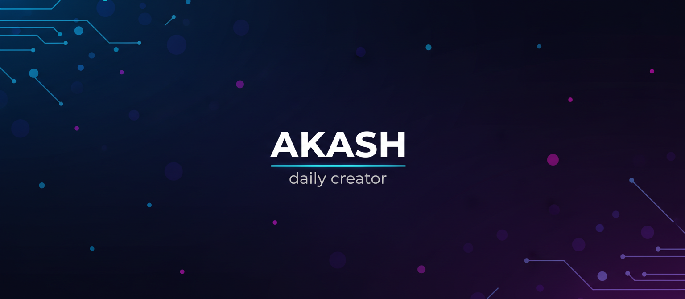
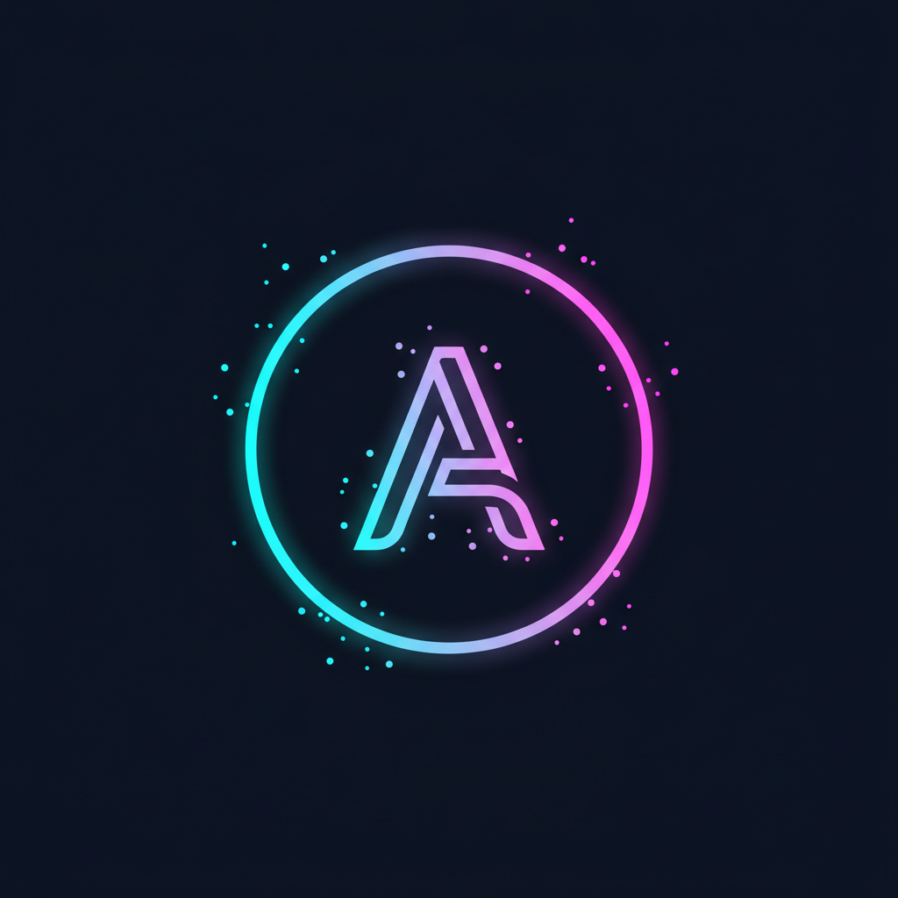

  

<h1 align="center">Hi, I'm Akash 👋</h1>

  

  I build apps and automation that quietly run on their own, every single day.

---

### 🚀 Things I've built

- 🔁 [daily-video-uploader](https://github.com/aka645251-ai/daily-video-uploader) : a pipeline that runs itself end to end, one video a day
- 🌐 [token-helper](https://github.com/aka645251-ai/token-helper) : a companion web page for the pipeline

### 🛠 Tools I work with

  
  
  
  

### 📈 GitHub stats

  
  

---

<i>⚡ One idea in, one video out, every day.</i>

